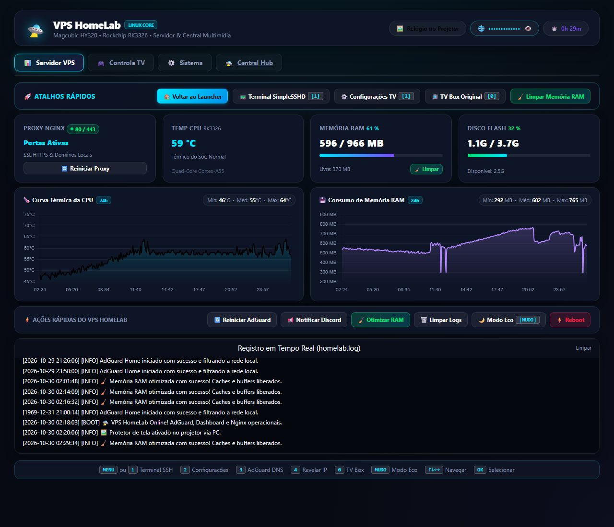
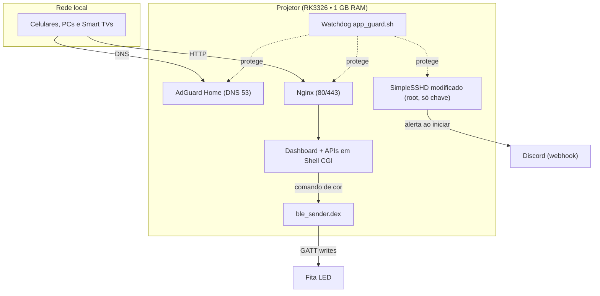
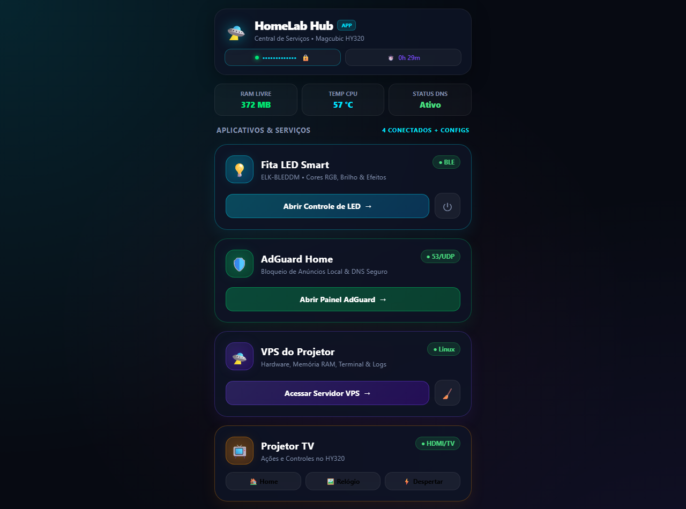
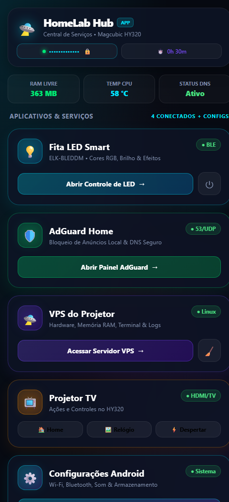

# 🛸 VPS HomeLab num projetor Android

> Um projetor smart (Magcubic HY320) que estava juntando poeira virou um HomeLab / mini VPS 24/7 na minha rede: AdGuard Home, Nginx, painel de telemetria, SSH só com chave e controle de fita LED por Bluetooth. Tudo num Rockchip RK3326 com 1 GB de RAM, feito em dupla com IA e com bastante engenharia reversa no caminho.

  

---

## 💡 A ideia

Eu tinha um projetor smart parado aqui em casa. Em vez de deixar na gaveta, quis ver até onde um aparelho desses aguenta como servidor de baixíssimo consumo.

Infraestrutura e sistemas embarcados não são a minha área, então fiz tudo em dupla com uma IA: ela me ajudou a abrir o aparelho por dentro, entender o hardware, descompilar APK e ler pacote Bluetooth. Eu levava o problema, ela ajudava a investigar.

## 🧰 O que está rodando

| | Serviço | O que faz |
| :-: | :-- | :-- |
| 🛡️ | **AdGuard Home** | DNS da casa (porta 53), com mais de 300 mil regras bloqueando anúncios e rastreadores em todos os aparelhos |
| 🌐 | **Nginx + dashboard** | Painel com CPU, RAM, disco e temperatura, com gráficos das últimas 24 h e ações rápidas |
| 🔐 | **SSH root só com chave** | Autenticação exclusivamente por chave Ed25519 (`.pem`), sem senha |
| 🔔 | **Alertas no Discord** | Aviso via webhook quando o servidor inicia |
| 💡 | **Fita LED por BLE** | Cor, brilho e efeitos controlados pelo navegador, sem app proprietário |
| 📺 | **Launcher do projetor** | Atalhos pelo controle remoto original, Modo Eco e limpeza de RAM |

## 🏗️ Arquitetura

## ⚙️ Hardware e software

| Componente | Detalhe |
| :-- | :-- |
| **SoC** | Rockchip RK3326, quad-core Cortex-A35 até 1,41 GHz |
| **GPU** | Mali-G31 MP2 |
| **RAM** | 1 GB (cerca de 966 MB visíveis ao sistema) + ~725 MB de swap ZRAM |
| **Armazenamento** | eMMC, partição `/data` com ~3,7 GB |
| **Rede e rádio** | Aicsemi AIC8800 (Wi-Fi dual band + Bluetooth 5.0 BLE) |
| **Sistema** | Android 12 (API 32), firmware *userdebug* com root nativo |
| **Kernel** | Linux 4.19.232, compilado com Linaro GCC 6.3.1 |

## 🥊 O desafio: sobreviver ao Low Memory Killer

Com 1 GB de RAM, o Android encerra qualquer processo em segundo plano para manter a interface fluida, o que derruba um servidor. Três medidas resolveram:

1. **ZRAM:** swap comprimido em RAM (`/dev/block/zram0`, ~725 MB), que aproveita melhor o 1 GB físico.
2. **Watchdog (`app_guard.sh`):** daemon em Bash que monitora os serviços e fixa `oom_score_adj = -1000` neles, a prioridade máxima do kernel.
3. **Limpeza de caches:** rotina que libera buffers inativos quando a memória livre chega perto do limite.

Resultado nas últimas 24 h do dashboard: RAM entre 292 e 765 MB (média de 602 MB), e CPU entre 46 e 64 °C (média de 55 °C), sem quedas dos serviços.

## 🔬 Engenharia reversa

### SimpleSSHD
O app de SSH que roda no Android foi descompilado e modificado para:
- manter a elevação de privilégio (root) de forma persistente, sem depender de interface aberta;
- disparar um evento para um **webhook do Discord** quando o projetor entra no Wi-Fi, informando o status e os serviços ativos.

### Fita LED por Bluetooth (BLE)
Em vez de usar o app comercial do controlador (cheio de anúncios e permissões), capturei e analisei os pacotes BLE:
- mapeei os comandos hexadecimais de energia, brilho e cor RGB;
- criei um executável Java/DEX (`ble_sender.dex`) que roda direto no shell do Android e envia os GATT writes pelo rádio do AIC8800;
- o dashboard web chama esse executável a cada cor ou modo escolhido.

## 📸 Demonstração

**Central de serviços (Hub)**

| Desktop | Celular |
| :-: | :-: |
|  |  |

**Telemetria e ações rápidas:** o painel no topo da página mostra CPU, RAM, disco e temperatura em tempo real, além de reiniciar o AdGuard ou o proxy, notificar o Discord, otimizar a RAM, ativar o Modo Eco e acompanhar o log do servidor.

## 🔐 Segurança

- **SSH sem senha:** só entra quem tem a chave privada. Não há senha pra adivinhar, então o ponto crítico passa a ser guardar bem essa chave.
- **Uso na rede local:** o projeto foi pensado para a rede de casa. Não recomendo expor nada disso diretamente na internet.
- **Segredos fora do repositório:** webhook, chaves, IPs e identificadores do aparelho não estão aqui, e o IP aparece mascarado nos prints.
- **Trade-offs conscientes:** root permanente e SELinux em modo permissivo facilitam tudo, mas ampliam o estrago se alguém conseguir acesso.

## ⚠️ Limitações

- Depende de um firmware com **root nativo** (*userdebug*). Em aparelhos de firmware travado, o caminho é outro.
- Com 1 GB de RAM, o espaço pra novos serviços é pequeno. Cada daemon extra precisa ser pensado.
- O controle da fita LED usa o protocolo do meu controlador. Outros modelos podem usar comandos diferentes.

## 🧠 O que aprendi

1. **Hardware parado costuma ser suficiente:** pra DNS, proxy e telemetria, um SoC de entrada dá conta quando a interface gráfica não compete por memória.
2. **IA como dupla de investigação:** ela acelerou o trabalho de ler pacote BLE e entender código descompilado, mas cada comando foi testado no aparelho real.
3. **Limite de memória é requisito de projeto:** no Android, quem não protege o processo do LMK perde o servidor.

## ⚖️ Aviso

Projeto feito para fins educacionais, estudo de sistemas embarcados e reaproveitamento de hardware. Mexer em firmware, root e SELinux pode danificar o aparelho ou deixá-lo vulnerável. Use por sua conta e risco.

---

**Desenvolvido por** [choicedev](https://github.com/choicedev) 🚀
